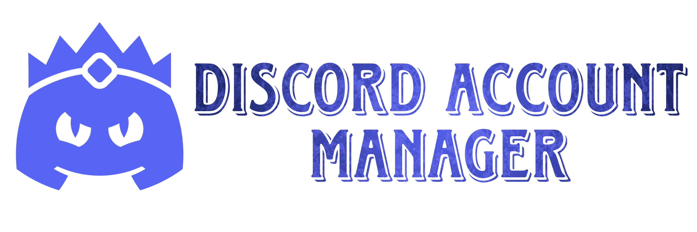
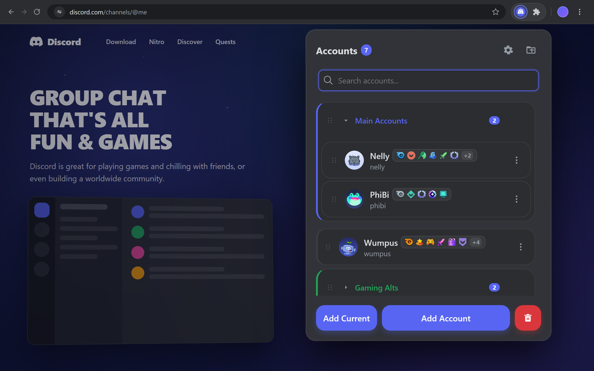
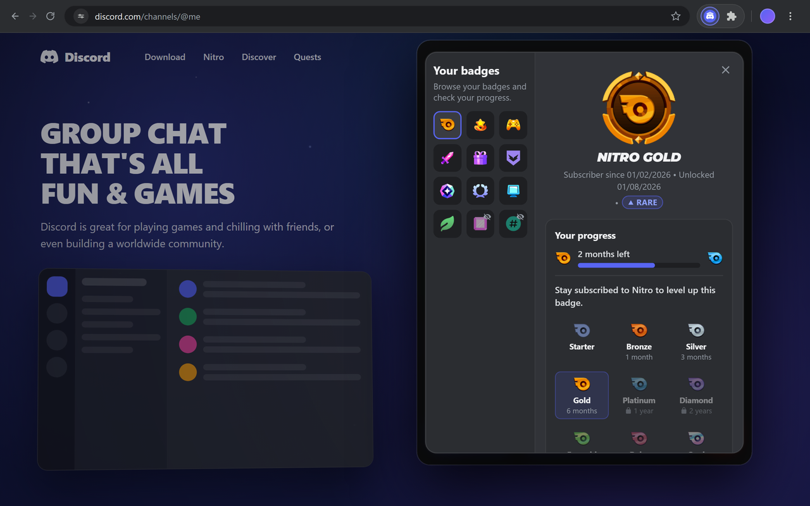
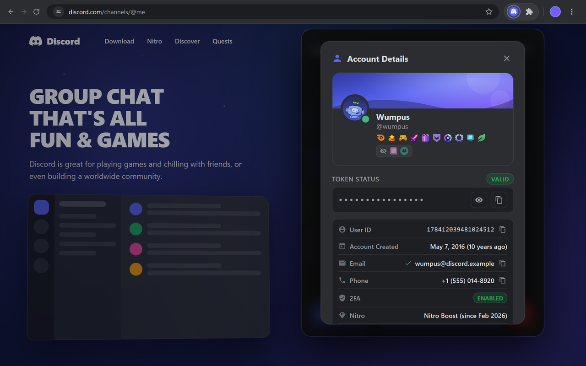
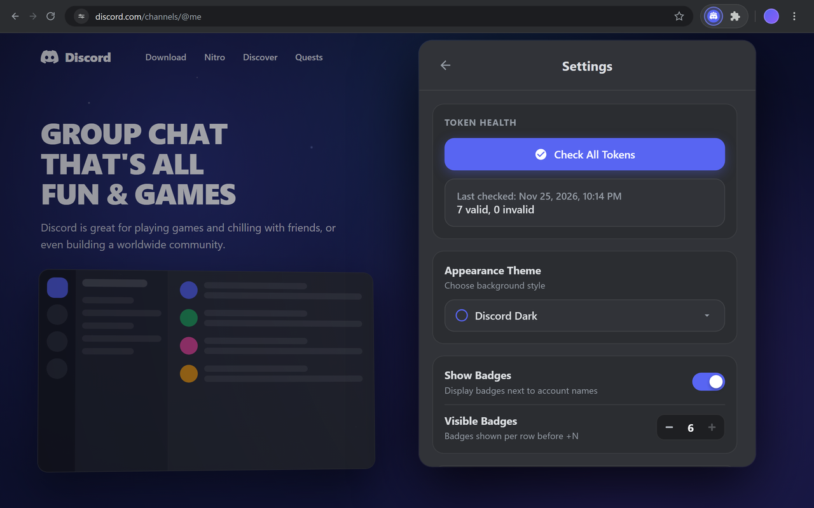

  

  Discord Account Manager is a modern browser extension that allows you to quickly switch between multiple Discord accounts, organize your accounts with folders, inspect Discord profile badges, and manage tokens securely in local storage.

  
  
  
  
  
  
  

---

# ✨ Features

- **🚀 Multi-Account Switching:** Save multiple Discord accounts with live avatars, presence indicators, and one-click switching.
- **📁 Color-Coded Folders & Drag-and-Drop:** Organize accounts into collapsible colored folders and reorder accounts or folders seamlessly.
- **🔍 Instant Search:** Filter accounts and folders by display name, username, or folder name in real time.
- **🏅 Discord Badges & Hover Previews:** View visible and hidden profile badges (`Nitro`, `Server Boosting`, `Gifting`, `Account Age`, `Game Time`, `Game Variety`, `Streaming`, `Quests`, `Orbs`, and legacy badges) with a Discord-style hover card, two-column Badges panel, progress bars, tier milestone grids, and configurable row limit (`3–6`).
- **👤 Rich Account Details:** Inspect profile banner and avatar (with one-click URL copy), User ID, masked token, creation date, email/verification, phone, 2FA status, Nitro tier, and folder assignment.
- **⚡ Auto Extract & Multiple Add Modes:** Extract the active Discord tab token in one click, paste single or bulk `.txt` tokens, or sign in via `discord.com/login` without disturbing existing sessions.
- **🩺 Health Checks & Backups:** Bulk validate saved tokens with health summaries and export or restore full JSON backups.
- **🎨 9 Themes & 13 Languages:** Switch between `Discord Dark`, `AMOLED`, `Light`, `Midnight Blurple`, `Retro Storm`, `Neon Nights`, `Sunset`, `Mint Apple`, and `Hanami` across 13 localized UI languages.
- **🛡️ Local-Only Privacy:** Tokens are stored exclusively in browser local storage (`chrome.storage.local`) and never transmitted to external third-party servers.

---

# 📸 Screenshots

<table>
  <tr>
    <td align="center"><b>Account List</b> </td>
    <td align="center"><b>Badges Panel</b> </td>
  </tr>
  <tr>
    <td align="center"><b>Account Details Modal</b> </td>
    <td align="center"><b>Settings</b> </td>
  </tr>
</table>

---

# 🛠️ Installation
1. [Click here](https://chromewebstore.google.com/detail/daibnnodfmdiodinihdmelconnbfgefo?utm_source=item-share-cb) to open the application page.
2. Install the application in your browser by clicking the **Add to Chrome** button. 

# 🛠️ Manual Installation

1. Download this repository to your local storage: [Discord Account Manager](https://github.com/lawerth/Discord-Account-Manager/archive/refs/heads/main.zip)
2. Open your browser (Chrome, Edge, or Brave) and navigate to the extensions page: `chrome://extensions`
3. Enable **Developer Mode** in the top right corner.
4. Click the **Load unpacked** button.
5. Select the main project folder you downloaded.

---

# ⚠️ Security Warning

This extension is open-source and designed for your security. However, **your Discord Token is just like your password.** Please do not share your tokens with anyone. The extension stores your data only in your local browser and does not perform any external data transfer.

---

# 📄 License

This project is licensed under the MIT License. See the `LICENSE` file for more information.
